<h1 align="center">Engage</h1>

<p align="center">
  <b>Comentarios para los artículos de Joomla, con moderación, protección contra spam y respeto a la privacidad.</b><br>
  Pensado para quien gestiona su propia web y quiere poder leer, aprobar y borrar comentarios sin complicaciones.
</p>

<p align="center">
  <a href="../../releases/latest"></a>
  
  
  <a href="LICENSE"></a>
</p>

<p align="center">
  <a href="../../releases/latest"></a><br>
  <sub>En la página que se abre, baje a «Assets» y descargue <code>pkg_engage-….zip</code>. No use el botón verde «Code».</sub>
</p>

<p align="center">
  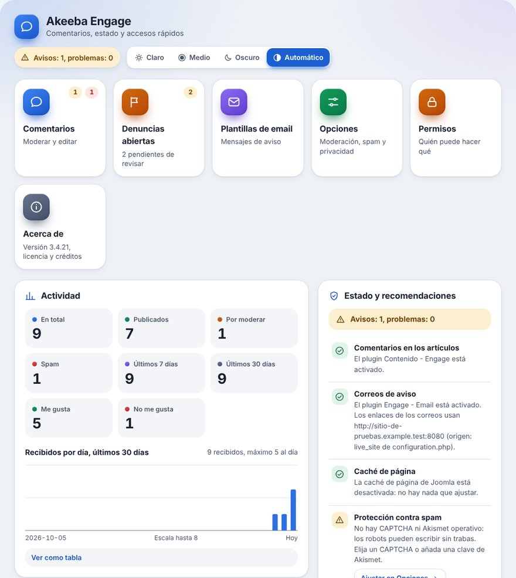
</p>

**Contenido:** [Qué hace](#qué-hace) · [Todas las opciones](#todas-las-opciones) · [Instalar](#instalar) · [Seguridad](#seguridad) · [Licencia](#autor-y-licencia)

## Qué hace

| Función | En una frase |
|---|---|
| **Comentarios en sus artículos** | Aparecen debajo de cada artículo, con respuestas anidadas, orden y páginas. |
| **Moderación** | Los comentarios nuevos pueden esperar su visto bueno; usted los publica, despublica, marca como spam o borra desde una lista. |
| **Protección contra spam** | CAPTCHA de Joomla, Akismet, casilla de condiciones y un botón «Denunciar» para los usuarios registrados. |
| **Avisos por correo** | Llegan a moderadores, al autor del artículo y a quien sigue la conversación, con enlace para darse de baja. |
| **Reacciones** | «Me gusta», «no me gusta» y favorito en cada comentario. |
| **Privacidad** | La IP y el navegador se borran a los 12 meses como máximo, se informa bajo el formulario y Gravatar solo se carga si el visitante lo acepta. |
| **Panel y permisos** | Un panel con números y estado, y una matriz para decidir quién puede comentar, editar, moderar o borrar. |

**Probado en:** Joomla 6.1.4, PHP 8.3 y MariaDB 10.11, con la plantilla Cassiopeia en la web y Atum en la administración, y con Chromium como navegador. **No probado:** Joomla 5.x, otras versiones de PHP, MySQL, otros navegadores ni otras plantillas. Detalle en [`docs/RESULTADOS-PRUEBAS-JOOMLA-REAL.md`](docs/RESULTADOS-PRUEBAS-JOOMLA-REAL.md).

**Requisitos:** Joomla 5.0 o superior (incluido Joomla 6), PHP 8.1 o superior y MySQL 8.0.13 o MariaDB 10.4 o superior. No funciona con PostgreSQL.

## Todas las opciones

Las capturas están en un sitio de pruebas con datos inventados (personas y correos ficticios). Están hechas con Joomla sin el paquete oficial de idioma, así que algunos textos propios de Joomla (no de Engage) salen traducidos a mano o en inglés. Cada pantalla tiene su captura plegada: pulse «Ver la pantalla» para abrirla.

Las opciones marcadas *(solo superadministradores)* solo las puede cambiar quien tiene el permiso «Administrador» de Joomla sobre Engage.

### Panel de control

<!-- claves: ninguna -->
Es la pantalla de entrada (menú de administración › Akeeba Engage). Reúne:

- **Accesos rápidos:** Comentarios (con insignias de pendientes y de spam), Denuncias abiertas, Plantillas de email, Opciones y Permisos.
- **Actividad:** comentarios en total, publicados, por moderar y spam; los de los últimos 7 y 30 días; los «me gusta» y «no me gusta»; y un gráfico de los últimos 30 días (con la opción «Ver como tabla»).
- **Estado y recomendaciones:** un semáforo que avisa, por ejemplo, de que falta un CAPTCHA o de que un plugin está desactivado, con un botón para ir a arreglarlo.
- **Últimos comentarios** con acciones rápidas, y tres diseños del panel (Claro, Medio y Oscuro, o automático).

No carga nada de servidores externos. Más detalle en [`docs/PANEL.md`](docs/PANEL.md).

<details><summary>Ver la pantalla: Panel de control de Engage</summary>


</details>

### Comentarios (lista)

<!-- claves: filter_comments -->
Todos los comentarios del sitio en una lista. Puede marcar varios y publicarlos, despublicarlos, marcarlos como «Posible SPAM», usar «SPAM y eliminar», «No es SPAM y publicar» o eliminarlos. Cada fila tiene «Editar», «Filtrar por contenido» y «Ver contenido», y muestra cuántos comentarios tiene el artículo y las reacciones.

| Filtro | Para qué sirve |
|---|---|
| `search` | Busca por texto del comentario, nombre o correo. |
| `enabled` | Filtra por estado: publicado, sin publicar, posible spam o spam. |
| `itemtype` | Filtra por tipo de contenido (por ejemplo, artículos). |
| `itemid` | Filtra por un contenido concreto (se ofrecen los que más comentarios tienen). |
| `since` | Solo los enviados desde esta fecha y hora. |
| `to` | Solo los enviados hasta esta fecha y hora. |
| `fullordering` | Orden de la lista: número, autor, estado o fecha, de menor a mayor o al revés. |
| `limit` | Cuántos comentarios se ven por página. |

<details><summary>Ver la pantalla: Lista de comentarios</summary>

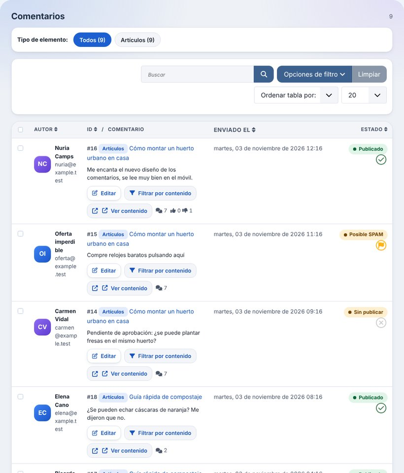

</details>

### Editar un comentario

<!-- claves: comment -->
Se abre con «Editar». Puede cambiar el estado y el texto; el resto son datos de solo consulta.

| Campo | Qué es |
|---|---|
| `enabled` | Estado del comentario (publicado, sin publicar, posible spam o spam). |
| `created_by` | Cuenta de usuario que lo escribió (vacía si fue un invitado). |
| `name` | Nombre que dio quien comentó. |
| `email` | Correo que dio quien comentó. |
| `created` | Fecha y hora de envío. |
| `ip` | Dirección IP (se borra pasado el plazo de conservación). |
| `user_agent` | Datos del navegador (también se borran pasado el plazo). |
| `modified` | Fecha del último cambio. |
| `modified_by` | Quién hizo el último cambio. |
| `body` | Texto del comentario (editor de Joomla). |

<details><summary>Ver la pantalla: Editar un comentario</summary>

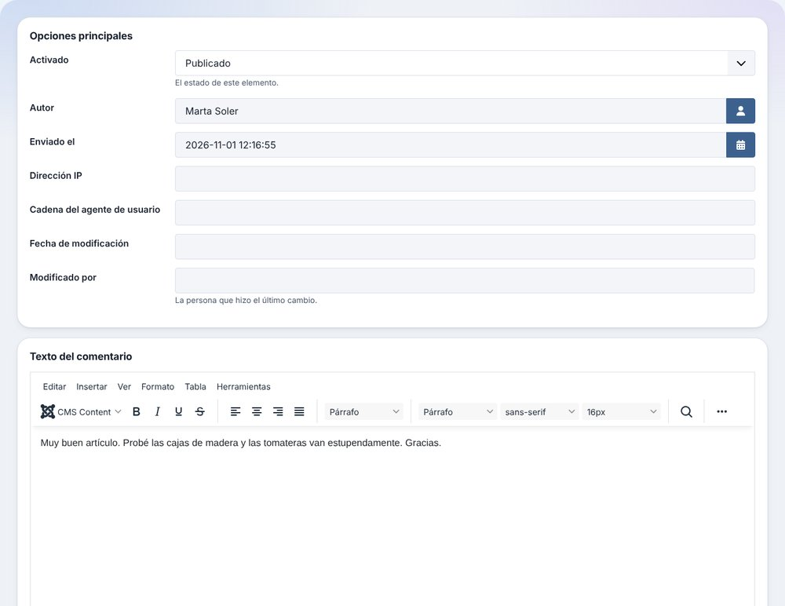

</details>

### Plantillas de correo

<!-- claves: ninguna -->
Engage usa las plantillas de correo de Joomla (Sistema › Plantillas de correo). Esta pantalla las instala o actualiza y lista las cinco que usa:

- **Comentario pendiente de moderación** (para moderadores).
- **Posible spam pendiente de moderación** (para moderadores).
- **Respuesta a un comentario** (para quien sigue la conversación).
- **Nuevo comentario publicado** (para moderadores).
- **Nuevo comentario en su contenido** (para el autor del artículo).

Botones: **Instalar o actualizar** (respeta las plantillas que usted haya modificado), **Restablecer** (borra y reinstala todas, incluidas las modificadas), **Editar** (abre la plantilla en Joomla) y **Vista previa** (muestra el correo con datos de ejemplo, sin enviar nada). El diseño, el aviso de confidencialidad y el color se eligen en [Notificaciones](#opciones-notificaciones). Más detalle en [`docs/CORREOS.md`](docs/CORREOS.md).

<details><summary>Ver la pantalla: Plantillas de correo</summary>

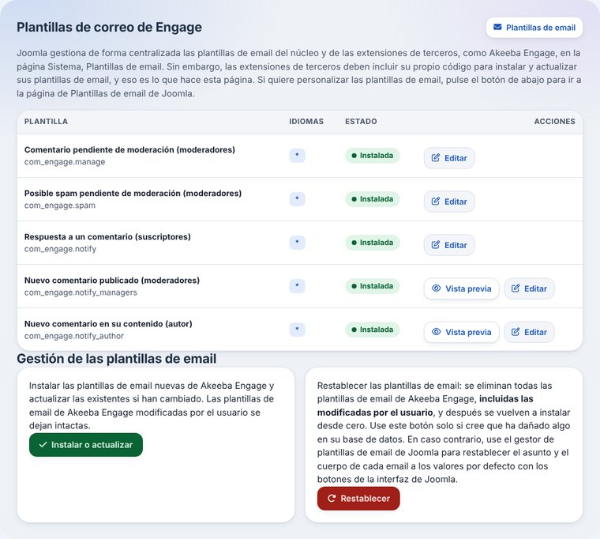

</details>

### Opciones

<!-- claves: ninguna -->
Menú de administración › Akeeba Engage › **Opciones**. Es una pantalla con ocho categorías y los cambios se guardan en el momento en que los hace. Las opciones de Akismet, correos y Gravatar (que en realidad son de sus plugins) están aquí mismo. La pantalla clásica de Joomla sigue disponible con «Opciones clásicas». Abajo, cada categoría con todas sus opciones.

<a id="opciones-design"></a>

#### Opciones: Diseño

<!-- claves: config, -->
Cómo se ven los comentarios en su web y cómo se muestran las respuestas.

| Opción | Qué hace | Valores |
|---|---|---|
| **Tema visual** (`theme`) | Aspecto de los comentarios, las respuestas y el formulario. Clásico es el aspecto original y no cambia nada. | Clásico (aspecto original) / Moderno / Minimalista / Oscuro. Por defecto: Clásico (aspecto original) |
| **Avatar en móvil** (`mobile_avatar`) | Si se muestra la foto de quien comenta en pantallas estrechas (menos de 576 px). | Automático / Mostrar / Ocultar. Por defecto: Automático |
| **Avatar genérico en los comentarios sin foto** (`generic_avatar`) | Qué se muestra junto a los comentarios sin foto: el círculo genérico de Engage o nada. | No mostrar / Mostrar. Por defecto: Mostrar |
| **Campo de usuario con la foto** (`customfield_avatar`) | Campo de usuario de Joomla (Usuarios > Campos) del que se toma la foto de quien comenta (imagen, lista de imágenes, URL o texto con la ruta). *(solo superadministradores)* | userfieldavatar |
| **Insignias «Autor» y «Moderador»** (`show_badges`) | Junto al nombre de quien comenta aparece la insignia «Autor» si es el autor del artículo y la insignia «Moderador» si puede moderar los comentarios. | No / Sí. Por defecto: Sí |
| **Botón «Copiar enlace»** (`copy_link`) | Se añade a cada comentario publicado un botón que copia al portapapeles el enlace permanente del comentario. Necesita JavaScript; sin él el botón no se muestra. | No / Sí. Por defecto: Sí |
| **Nivel máximo de anidación de comentarios** (`max_level`) | Hasta cuántos niveles se anidan las respuestas (1 = sin respuestas anidadas). Solo afecta a las respuestas nuevas. | número entero de 1 a 6. Por defecto: 3 |
| **Mostrar a quién contesta una respuesta** (`reply_show_quote`) | Se muestra una línea pequeña «En respuesta a <nombre>» en cada respuesta, con un enlace al comentario al que contesta. | No / Sí. Por defecto: Sí |
| **Sangría de las respuestas** (`reply_indent`) | Cuánto se desplaza a la derecha cada nivel de anidación. El valor por defecto es Media. | Ninguna / Pequeña / Media / Grande. Por defecto: Media |
| **Marca visual de las respuestas** (`reply_style`) | Cómo se destacan las respuestas. Línea lateral conserva la línea de color junto a cada comentario (el aspecto original). | Línea lateral / Fondo suave / Ninguna. Por defecto: Línea lateral |
| **Orden de los comentarios** (`comments_ordering`) | Orden de los comentarios, por fecha. Ascendente muestra primero los comentarios más antiguos. Descendente muestra primero los más recientes. | Ascendente / Descendente. Por defecto: Ascendente |
| **Selector de orden y favoritos** (`sort_selector`) | Sobre la lista aparece el selector «Ordenar por» (Más recientes, Más antiguos y, con las reacciones activadas, Más valorados) y, para quien ha iniciado sesión, el botón «Solo mis favoritos». | No / Sí. Por defecto: Sí |
| **Orden inicial** (`default_sort`) | Orden que se aplica mientras el visitante no elija otro. Automático respeta la opción «Orden de los comentarios» de siempre. «Más valorados» solo se aplica si las reacciones están activadas. | Automático / Más recientes / Más antiguos / Más valorados. Por defecto: Automático |
| **Interfaz de comentarios** (`comments_show`) | Muestra u oculta toda la zona de comentarios. Si se oculta, no se ve ninguno ni se admiten nuevos. | Mostrar / Ocultar. Por defecto: Mostrar |
| **Resumen en la vista de destacados** (`comments_show_featured`) | Dónde se muestra el número de comentarios de cada artículo en la vista de artículos destacados de Joomla. | Ocultar / Antes del contenido / Después del contenido. Por defecto: Antes del contenido |
| **Resumen en la vista de blog** (`comments_show_category`) | Dónde se muestra el número de comentarios de cada artículo en la vista de blog de Joomla. | Ocultar / Antes del contenido / Después del contenido. Por defecto: Antes del contenido |
| **Resumen en el módulo Newsflash** (`comments_show_article`) | Dónde se muestra el número de comentarios de cada artículo en el módulo Newsflash de Joomla. | Ocultar / Antes del contenido / Después del contenido. Por defecto: Antes del contenido |

<details><summary>Ver la pantalla: Opciones, categoría Diseño</summary>

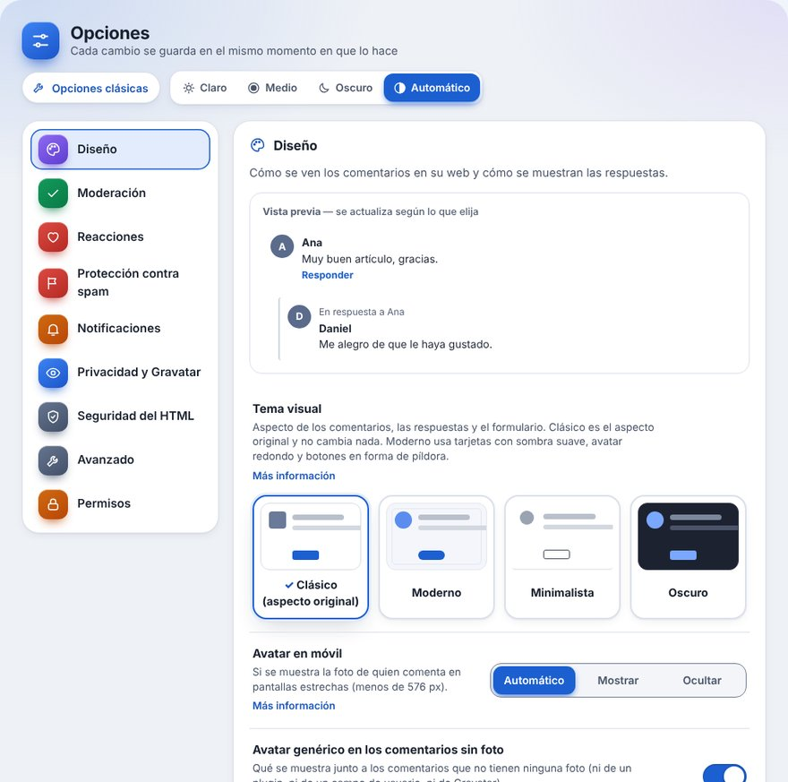

</details>

<a id="opciones-moderation"></a>

#### Opciones: Moderación

<!-- claves: config, -->
Si los comentarios esperan aprobación, cuánto pueden durar, cuándo se cierran y los límites de las denuncias.

| Opción | Qué hace | Valores |
|---|---|---|
| **Nuevos comentarios** (`default_publish`) | Si los comentarios nuevos se publican al instante o esperan a que un moderador los apruebe. | Publicado / Sin publicar. Por defecto: Publicado |
| **Permitir nuevos comentarios** (`comments_enabled`) | Permite o bloquea los comentarios nuevos (los existentes se siguen viendo). | No / Sí. Por defecto: Sí |
| **Cerrar comentarios cuando pasen estos días** (`comments_close_after`) | Los comentarios se cierran solos pasados estos días desde la publicación del artículo (0 = nunca). | número entero de 0 a 3650. Por defecto: 0 |
| **Longitud mínima del comentario** (`min_length`) | Longitud mínima del comentario en bytes (0 = sin mínimo). | número. Por defecto: 0 |
| **Longitud máxima del comentario** (`max_length`) | Longitud máxima del comentario en bytes (0 = sin máximo; el servidor aplica siempre un tope duro de 20 000). | número. Por defecto: 0 |
| **Número de comentarios por página** (`default_limit`) | Cuántos comentarios se muestran a la vez en cada página. Evite valores muy altos en contenidos con muchísimos comentarios. | 5 / 10 / 15 / 20 / 25 / 30 / 50 / 100 / 200 / 500 / Todos. Por defecto: 20 |
| **Permitir denunciar comentarios** (`reports_enabled`) | Los usuarios registrados (nunca los invitados) ven un botón «Denunciar» en los comentarios. *(solo superadministradores)* | No / Sí. Por defecto: Sí |
| **Denuncias por usuario y hora** (`reports_per_hour`) | Máximo de denuncias que puede enviar una persona en una hora (1 a 20; por defecto 5). *(solo superadministradores)* | número entero de 1 a 20. Por defecto: 5 |
| **Denuncias por usuario y día** (`reports_per_day`) | Máximo de denuncias que puede enviar una persona en 24 horas (1 a 100; por defecto 20). *(solo superadministradores)* | número entero de 1 a 100. Por defecto: 20 |
| **Antigüedad mínima de la cuenta (horas)** (`reports_min_account`) | Horas que debe tener una cuenta para poder denunciar (0 a 720; por defecto 24). Frena a los robots que se registran y denuncian de inmediato. *(solo superadministradores)* | número entero de 0 a 720. Por defecto: 24 |
| **Tope de denuncias abiertas** (`reports_open_max`) | Número máximo de denuncias abiertas a la vez en todo el sitio (50 a 5000; por defecto 500). *(solo superadministradores)* | número entero de 50 a 5000. Por defecto: 500 |
| **Avisar a los moderadores por correo** (`reports_notify`) | Si está activado, los moderadores reciben UN correo agrupado (como máximo cada 8 horas) con el número de denuncias nuevas, y no uno por denuncia. *(solo superadministradores)* | No / Sí. Por defecto: No |

<details><summary>Ver la pantalla: Opciones, categoría Moderación</summary>

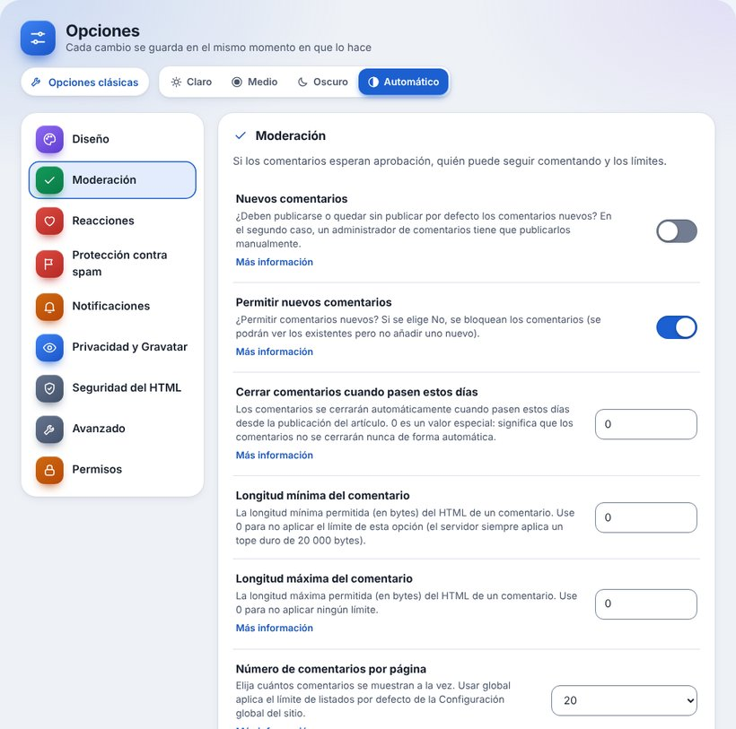

</details>

<a id="opciones-reactions"></a>

#### Opciones: Reacciones

<!-- claves: config, -->
Botones de «me gusta», «no me gusta» y favorito bajo cada comentario.

| Opción | Qué hace | Valores |
|---|---|---|
| **Botones de reacción** (`reactions_enabled`) | Los botones de «me gusta», «no me gusta» y favorito aparecen abajo a la derecha de cada comentario publicado, en la misma línea que «Responder». | No / Sí. Por defecto: Sí |
| **Botón «No me gusta»** (`reactions_dislike`) | Con esta opción aparece el botón de «no me gusta» (pulgar abajo) y su contador. «Me gusta» y «no me gusta» se excluyen entre sí para cada persona y nadie puede valorar su propio comentario. | No / Sí. Por defecto: Sí |
| **Botón de favorito** (`reactions_favorites`) | Con esta opción aparece el botón de favorito (estrella). El favorito es personal y privado: solo quien lo marca ve la estrella y el fondo amarillo del comentario, y no hay contador público. | No / Sí. Por defecto: Sí |
| **Quién puede reaccionar** (`reactions_who`) | Usuarios registrados: cualquier persona con cuenta que haya iniciado sesión. Solo quien puede comentar: las personas cuyo grupo tiene permiso para crear comentarios. | Usuarios registrados / Solo quien puede comentar. Por defecto: Usuarios registrados |

<details><summary>Ver la pantalla: Opciones, categoría Reacciones</summary>

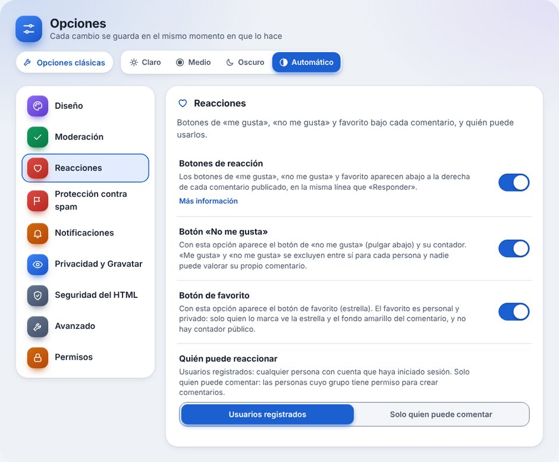

</details>

<a id="opciones-antispam"></a>

#### Opciones: Protección contra spam

<!-- claves: config,akismet -->
CAPTCHA, Akismet y casilla de condiciones.

| Opción | Qué hace | Valores |
|---|---|---|
| **CAPTCHA para los comentarios** (`captcha`) | Plugin CAPTCHA de Joomla que se usa en el formulario de comentarios. *(solo superadministradores)* | No usar |
| **Usar CAPTCHA con estos usuarios** (`captcha_for`) | ¿A qué usuarios que envían un comentario se les debe mostrar el CAPTCHA definido arriba? *(solo superadministradores)* | Invitados / Cualquiera salvo los administradores de comentarios / Todos. Por defecto: Invitados |
| **Los invitados deben aceptar las condiciones** (`tos_accept`) | Si se activa, se pedirá a los usuarios invitados que marquen una casilla para aceptar las condiciones de uso y / o la política de privacidad de su sitio. | No / Sí. Por defecto: No |
| **Texto de la casilla de condiciones** (`tos_prompt`) | Introduzca el texto que se mostrará junto a la casilla que los usuarios deberán marcar para enviar un comentario. | texto |
| **Clave de Akismet** (`key`) | Su clave de API de Akismet (se obtiene en la cuenta de Akismet). | texto |
| **Comentarios que se comprueban en busca de SPAM** (`check`) | ¿Qué comentarios se deben comprobar en busca de SPAM? | Todos / Quien no sea administrador / Invitados. Por defecto: Quien no sea administrador |
| **Descartar el SPAM evidente** (`discard_blatant`) | Si se activa, los comentarios identificados como SPAM evidente se eliminarán de inmediato en lugar de guardarse y marcarse como SPAM. | No / Sí. Por defecto: Sí |

<details><summary>Ver la pantalla: Opciones, categoría Protección contra spam</summary>

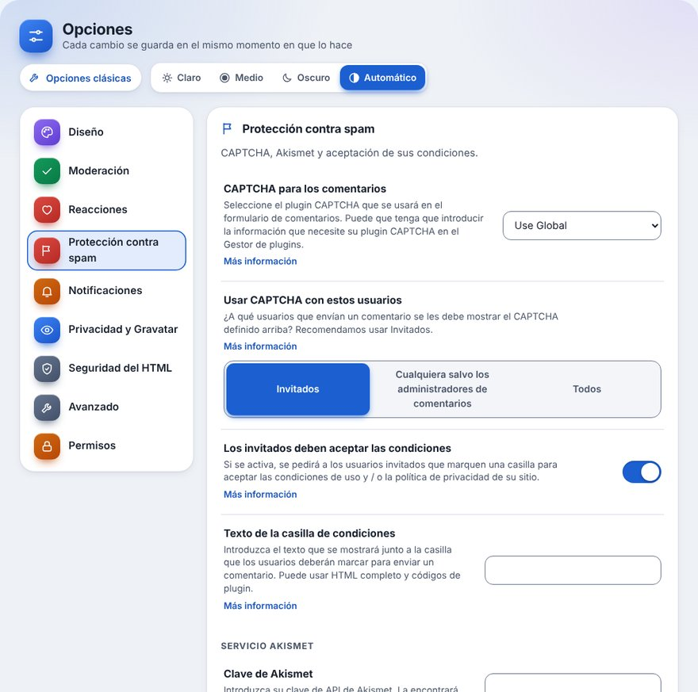

</details>

<a id="opciones-notifications"></a>

#### Opciones: Notificaciones

<!-- claves: config,email -->
Quién recibe un correo cuando alguien comenta y cómo se ven esos correos.

| Opción | Qué hace | Valores |
|---|---|---|
| **Notificar al autor** (`comments_notify_author`) | ¿Notificar (enviar emails) al autor del contenido de todos los comentarios nuevos publicados en su contenido? | No / Sí. Por defecto: Sí |
| **Notificar a los usuarios** (`comments_notify_users`) | ¿Notificar (enviar emails) a los usuarios cuando se envía una respuesta a un comentario que publicaron en el contenido? | No / Sí. Por defecto: Sí |
| **Incluir enlaces en los correos** (`email_include_links`) | Los correos llevan los enlaces al comentario y, para moderadores, los botones de moderación de un clic. | No / Sí. Por defecto: Sí |
| **URL base de los enlaces de los correos** (`email_base_url`) | Dirección pública del sitio con la que se construyen los enlaces de los correos de aviso (moderación, baja, enlace al comentario), por ejemplo https://www.example.com o https://www.example.com/blog. *(solo superadministradores)* | texto |
| **Diseño HTML enriquecido en los correos** (`email_rich`) | Los correos de aviso salen con un diseño HTML cuidado (cabecera con el nombre del sitio, botones y pie; compatible con modo oscuro). | No / Sí. Por defecto: Sí |
| **Mostrar aviso de confidencialidad** (`email_confidential`) | Sí (por defecto): los correos de aviso llevan al pie un aviso de confidencialidad y de protección de datos (RGPD) y, a los suscriptores, cómo darse de baja. *(solo superadministradores)* | No / Sí. Por defecto: Sí |
| **Color de acento de los correos** (`email_accent`) | Color de la cabecera y de los botones del diseño HTML enriquecido (lista cerrada; no se admiten valores libres). | Azul / Violeta / Verde / Rojo / Naranja / Pizarra. Por defecto: Azul |
| **Notificar a los administradores de comentarios todos los comentarios** (`managers_notify`) | ¿Notificar a los administradores de comentarios también los comentarios publicados automáticamente, que no necesitan moderar y que no son respuesta a un comentario suyo? | No / Sí. Por defecto: No |
| **Notificar a los administradores de comentarios los comentarios SPAM** (`managers_notify_spam`) | ¿Notificar a los administradores de comentarios cuando el mensaje recibido ya está marcado como SPAM (por ejemplo, por el plugin de integración con Akismet)? | No / Sí. Por defecto: No |

<details><summary>Ver la pantalla: Opciones, categoría Notificaciones</summary>

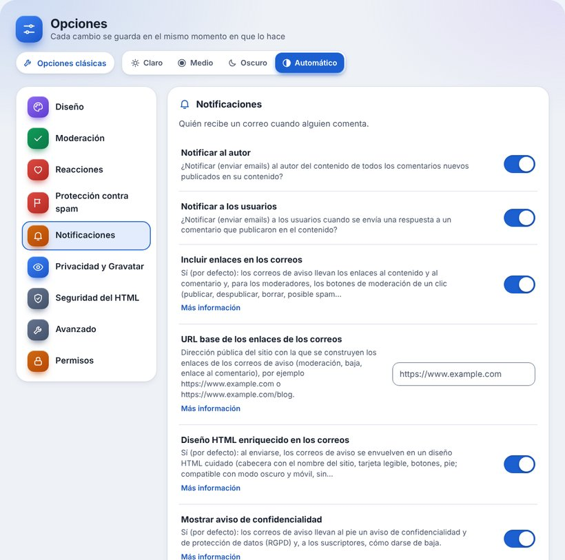

</details>

<a id="opciones-privacy"></a>

#### Opciones: Privacidad y Gravatar

<!-- claves: config,gravatar -->
Plazo de conservación de la IP, enlace a su política de privacidad y fotos de Gravatar.

| Opción | Qué hace | Valores |
|---|---|---|
| **Conservar IP y navegador de los comentarios (meses)** (`retention_months`) | Meses que se conservan la dirección IP y los datos del navegador de cada comentario (de 1 a 12; por defecto 12). *(solo superadministradores)* | número entero de 1 a 12. Por defecto: 12 |
| **Enlace a la política de privacidad** (`privacy_url`) | Dirección de su política de privacidad, que se enlaza bajo el formulario de comentarios. *(solo superadministradores)* | texto |
| **Modo de Gravatar** (`mode`) | Este ajuste controla cuándo el navegador del visitante puede contactar con gravatar.com (esto envía la IP del visitante a un tercero). | Preguntar antes al visitante (recomendado) / Desactivado (nunca contactar con Gravatar) / Siempre (sin pedir consentimiento). Por defecto: Preguntar antes al visitante (recomendado) |
| **Mostrar el aviso de consentimiento** (`show_notice`) | Se muestra encima de los comentarios el aviso propio del plugin con el botón de aceptar. | No / Sí. Por defecto: Sí |
| **Quién decide (origen del consentimiento)** (`consent_source`) | Solo se aplica en el modo Preguntar. Aviso propio de Engage: el plugin muestra su propio botón encima de los comentarios (por defecto, sin cambios). | Aviso propio de Engage (por defecto) / Módulo JBCookies (gestor de cookies). Por defecto: Aviso propio de Engage (por defecto) |
| **Grupo de JBCookies (opcional)** (`jbcookies_group`) | Déjelo VACÍO (recomendado para empezar): las fotos solo se cargan cuando el visitante hace clic en Aceptar todas en JBCookies. | texto |
| **Mostrar enlace al perfil** (`profile_link`) | ¿Debe enlazarse el avatar con la página pública del perfil de Gravatar? | No / Sí. Por defecto: Sí |
| **Clasificación** (`rating`) | Clasificación de contenido que se permite a los avatares de Gravatar: G apta para todos; X no apta para el trabajo. | G (Apta para todos los públicos) / PG (Gestos groseros, desnudez parcial, palabrotas, violencia leve) / R (Lenguaje muy soez, violencia intensa, desnudez, consumo de drogas duras) / X (Imágenes sexuales explícitas, violencia extremadamente perturbadora). Por defecto: G (Apta para todos los públicos) |
| **Imagen por defecto** (`default_image`) | El avatar que se muestra si el usuario no tiene uno creado en Gravatar. Si se elige personalizada, seleccione una imagen en el campo de abajo. | Persona misteriosa / Identicon / MonsterID / Wavatar / Retro / RoboHash / Imagen en blanco / Imagen personalizada. Por defecto: Persona misteriosa |
| **Forzar imagen por defecto** (`force_default`) | ¿Mostrar siempre la imagen por defecto aunque el usuario tenga un Gravatar? | No / Sí. Por defecto: No |

<details><summary>Ver la pantalla: Opciones, categoría Privacidad y Gravatar</summary>

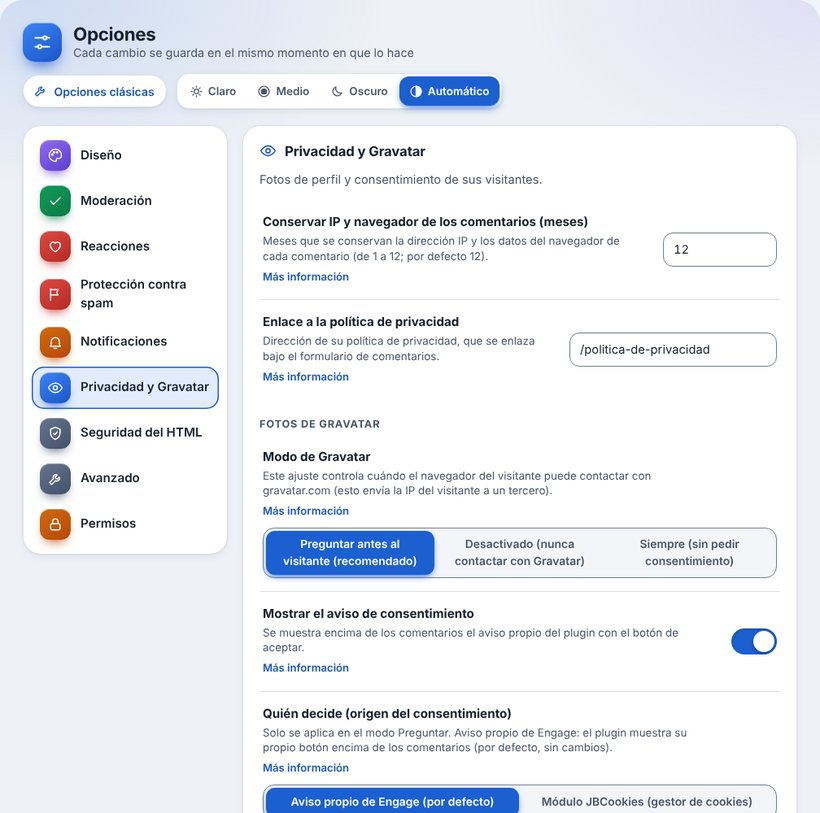

</details>

<a id="opciones-security"></a>

#### Opciones: Seguridad del HTML

<!-- claves: config, -->
Qué formato HTML pueden usar los visitantes dentro de un comentario.

| Opción | Qué hace | Valores |
|---|---|---|
| **Modo de filtrado** (`filter_mode`) | Cómo se limpia el HTML de los comentarios: con los filtros de texto de Joomla, con HTML Purifier o con HTML Purifier y una lista mínima de etiquetas (lo más estricto, por defecto). *(solo superadministradores)* | Filtros de texto de Joomla / HTML Purifier / HTML Purifier (permitir HTML mínimo). Por defecto: HTML Purifier (permitir HTML mínimo) |
| **HTML Purifier usa la configuración de los filtros de texto de Joomla** (`htmlpurifier_config_joomla`) | Hace que HTML Purifier use la lista de etiquetas de los filtros de texto de Joomla en vez de la suya. *(solo superadministradores)* | No / Sí. Por defecto: No |
| **Lista blanca de HTML Purifier** (`htmlpurifier_configstring`) | Lista de etiquetas y atributos permitidos en los comentarios (una por línea o separadas por comas); solo se usa si no se aplica la configuración de Joomla. *(solo superadministradores)* | texto (una línea por regla) |
| **Inclusión de HTML Purifier** (`htmlpurifier_include`) | Cómo se carga la biblioteca HTML Purifier. Si no está seguro, deje «Composer». *(solo superadministradores)* | Composer / Autocargador / Todo a la vez. Por defecto: Composer |

<details><summary>Ver la pantalla: Opciones, categoría Seguridad del HTML</summary>

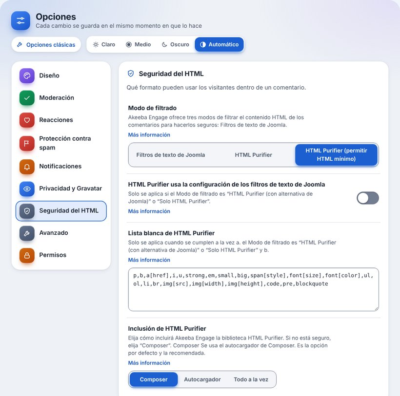

</details>

<a id="opciones-advanced"></a>

#### Opciones: Avanzado

<!-- claves: config, -->
Opciones técnicas. Los valores por defecto sirven para la mayoría de las webs.

| Opción | Qué hace | Valores |
|---|---|---|
| **Reducir el rastreo de robots** (`crawl_reduce`) | Evita que los robots de los buscadores recorran las direcciones de comentarios, orden y filtros, que de otro modo inflan el contador de visitas. | No / Sí. Por defecto: Sí |
| **Solución alternativa para las plantillas de email defectuosas de Joomla! 5.2 y posteriores.** (`workaround_mailtemplate`) | Solución alternativa para las plantillas de correo de Joomla 5.2 y posteriores, que activan por defecto un diseño de plantilla de correo. Déjela activada salvo que tenga problemas. | No / Sí. Por defecto: Sí |
| **Servicio de información de IP** (`iplookup`) | Dirección de un servicio de consulta de IP; se usa al mostrar direcciones IP a los moderadores. *(solo superadministradores)* | texto |
| **Antigüedad máxima del SPAM** (`max_spam_age`) | Días que se conserva el spam antes de borrarlo automáticamente. | número entero de 0 a 365. Por defecto: 15 |
| **Cargar CSS personalizado** (`loadCustomCss`) | Carga la hoja de estilos propia de Engage. Úsela solo si su plantilla no usa Bootstrap 5. | No / Sí. Por defecto: No |
| **Área de comentarios oculta por defecto** (`comments_reply_bad_ux`) | ¿Debe ocultarse por defecto el área de comentarios / respuestas? Si es así, en su lugar aparecerá un botón Deje su comentario. | No / Sí. Por defecto: No |
| **Mostrar ‘Espere un momento’ en el botón mientras se envía el comentario** (`pleaseWait`) | Desactiva el botón de enviar y muestra «Espere un momento» mientras se envía el comentario. | No / Sí. Por defecto: No |
| **Módulo de inicio de sesión** (`login_module`) | Módulo de Joomla que se usa en la zona de inicio de sesión que ven los invitados (solo se cambia en las opciones clásicas). | Uno de los módulos de la lista o «No mostrar». Por defecto: mod_login |

<details><summary>Ver la pantalla: Opciones, categoría Avanzado</summary>

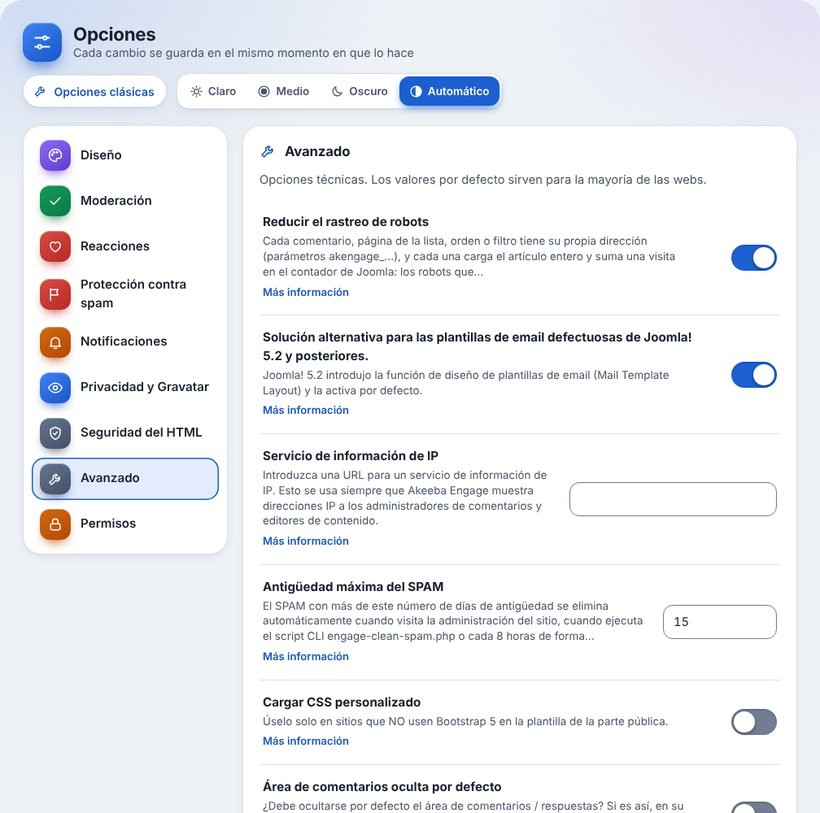

</details>

<a id="opciones-permisos"></a>

#### Opciones: Permisos

<!-- claves: ninguna -->
Abre directamente la [matriz de permisos](#matriz-de-permisos). Desde allí se llega a los permisos avanzados de Joomla.

### Matriz de permisos

<!-- claves: ninguna -->
Menú de administración › Akeeba Engage › **Permisos** (solo para quien tiene el permiso «Administrador» de Engage; los demás reciben un aviso de acceso denegado). Es una tabla sencilla de los permisos de Joomla sobre Engage: una fila por grupo de usuarios y una columna por acción.

| Columna | Permiso de Joomla | Para qué |
|---|---|---|
| Comentar | `core.create` | Escribir comentarios nuevos. |
| Editar los suyos | `core.edit.own` | Cambiar sus propios comentarios. |
| Editar cualquiera | `core.edit` | Cambiar los comentarios de otras personas. |
| Moderar | `core.edit.state` | Publicar, despublicar y marcar como spam. |
| Borrar | `core.delete` | Eliminar comentarios. |
| Entrar al panel | `core.manage` | Abrir Engage en la administración. |

Pulse una celda para alternar entre «permitido» y «sin asignar» y pulse **Guardar permisos**. La matriz nunca escribe una denegación, no toca los Super usuarios y pide confirmación si da un permiso delicado a un grupo amplio (Público, Invitado o Registrado). Los permisos «Administrador» y «Opciones» y las denegaciones a propósito solo se cambian en **Permisos avanzados (Joomla)**, un enlace que hay en la propia pantalla. Quién *ve* los comentarios no se decide aquí: lo decide el nivel de acceso del artículo. Más detalle en [`docs/PANEL.md`](docs/PANEL.md).

<details><summary>Ver la pantalla: Matriz de permisos</summary>

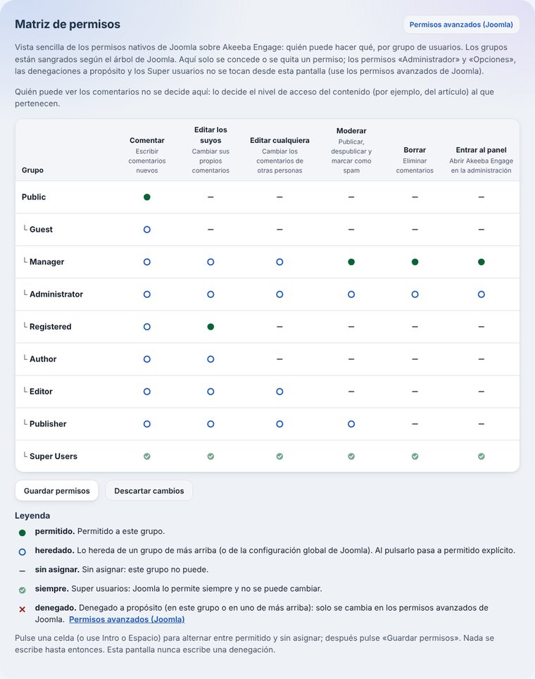

</details>

### Cola de denuncias

<!-- claves: reports -->
Menú de administración › Akeeba Engage › **Denuncias abiertas**. Los usuarios registrados (nunca los invitados) pueden denunciar un comentario ajeno con un motivo de una lista cerrada. Una denuncia **nunca** oculta ni borra nada por sí sola: usted decide, desde esta cola, si descarta la denuncia o despublica el comentario. Los límites (por hora, por día, antigüedad de la cuenta y tope de abiertas) están en [Opciones: Moderación](#opciones-moderation).

| Filtro | Para qué sirve |
|---|---|
| `status` | Denuncias abiertas, descartadas, atendidas o todas. |
| `reason` | Motivo: spam o publicidad, ofensivo o abusivo, contiene datos personales u otro motivo. |

Más detalle en [`docs/DENUNCIAS.md`](docs/DENUNCIAS.md).

<details><summary>Ver la pantalla: Cola de denuncias</summary>

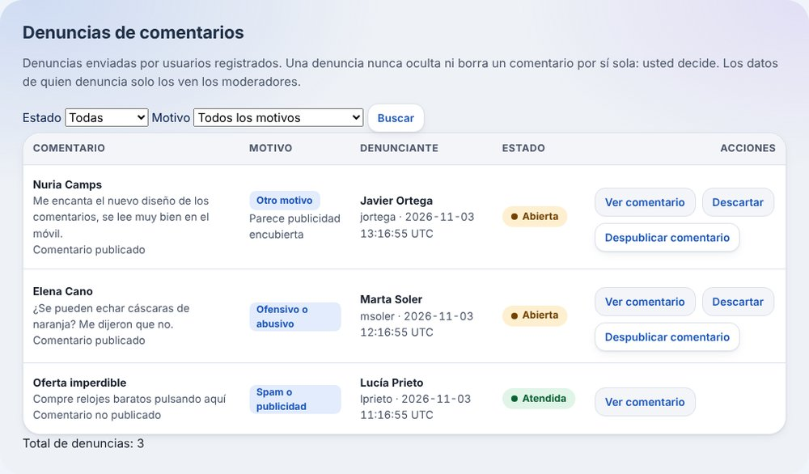

</details>

### Parte pública: comentarios y formulario

<!-- claves: comment_new -->
Debajo de cada artículo aparecen el número de comentarios, el selector «Ordenar por» (más recientes, más antiguos, más valorados), los comentarios con sus respuestas anidadas y los botones de copiar enlace, «me gusta», «no me gusta» y favorito. Debajo, el formulario y un **aviso de privacidad** que dice qué datos se guardan, para qué, por cuánto tiempo y que los correos llevan enlace de baja (con enlace a su política de privacidad si lo configura en [Opciones: Privacidad y Gravatar](#opciones-privacy)).

| Campo del formulario | Qué es |
|---|---|
| `name` | Nombre (solo se pide a los invitados). |
| `email` | Correo (solo se pide a los invitados; no se muestra). |
| `body` | Texto del comentario. |
| `captcha` | CAPTCHA de Joomla, si lo ha elegido en [Protección contra spam](#opciones-antispam). |
| `accept_tos` | Casilla de aceptación de condiciones, si la activa. |

<details><summary>Ver la pantalla: Comentarios de un artículo</summary>

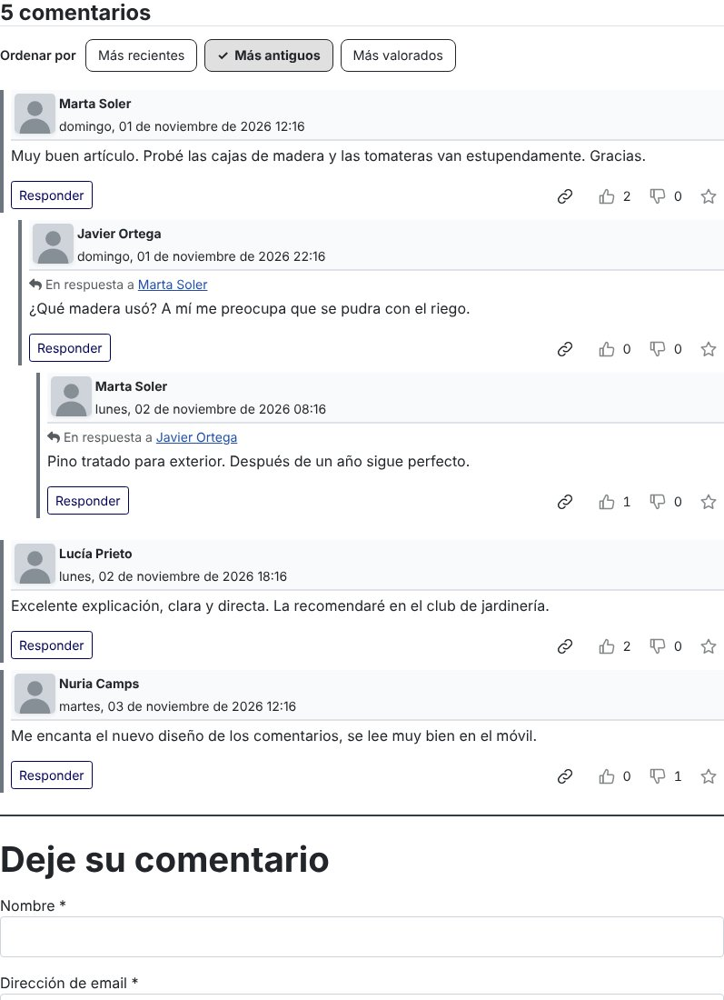

</details>

<details><summary>Ver la pantalla: Formulario y aviso de privacidad</summary>

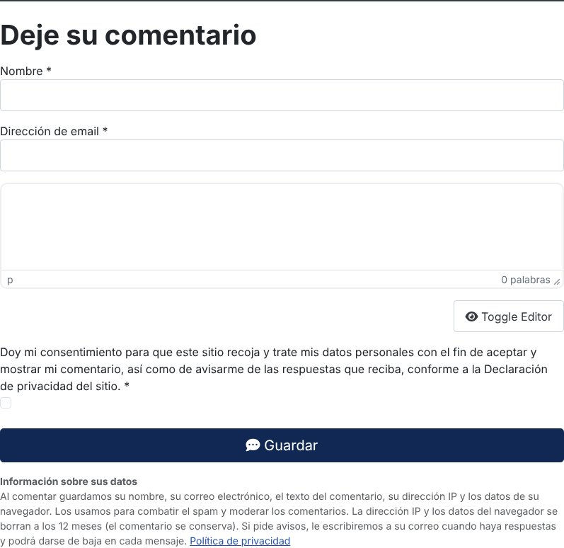

</details>

### Módulo «Últimos comentarios»

<!-- claves: mod -->
Un módulo de Joomla (Contenido › Módulos de sitio › Nuevo › «Akeeba Engage - Últimos comentarios») que muestra los últimos comentarios o los últimos artículos comentados en la posición que elija.

| Opción | Qué hace | Valores |
|---|---|---|
| **Qué mostrar** (`mode`) | Qué se lista: los últimos comentarios, o solo el último comentario de cada artículo. | Últimos comentarios / Últimos artículos comentados. Por defecto: Últimos comentarios |
| **Número de elementos** (`count`) | Cuántos elementos muestra el módulo. | número. Por defecto: 10 |
| **Mostrar el título del artículo** (`show_title`) | Muestra el título del artículo al que pertenece cada comentario. | No / Sí. Por defecto: Sí |
| **Enlazar el título del artículo** (`link_title`) | Hace que ese título sea un enlace al artículo. | No / Sí. Por defecto: No |
| **Mostrar el número de comentarios por artículo** (`show_count`) | Muestra cuántos comentarios tiene cada artículo. | No / Sí. Por defecto: Sí |
| **Mostrar extracto** (`excerpt`) | Muestra solo un extracto de cada comentario en vez del texto entero. | No / Sí. Por defecto: Sí |
| **Máximo de palabras del extracto** (`excerpt_words`) | Máximo de palabras del extracto. | número. Por defecto: 50 |
| **Longitud máxima del extracto (caracteres)** (`excerpt_characters`) | Máximo de caracteres del extracto. | número. Por defecto: 350 |
| **Modo de categorías** (`cat_mode`) | Si las categorías de la opción siguiente se incluyen o se excluyen. | Excluir / Incluir. Por defecto: Excluir |
| **Categorías** (`categories`) | Categorías que se incluyen o se excluyen, según el modo anterior. | una o varias categorías |
| **Disposición** (`layout`) | Plantilla de presentación del módulo (la de Joomla por defecto). | Las disposiciones que ofrezca su plantilla |
| **Sufijo de clase del módulo** (`moduleclass_sfx`) | Texto que se añade a la clase CSS del módulo para darle estilo propio. | texto |
| **Caché** (`cache`) | Si Joomla guarda en caché el contenido del módulo. | Usar global / Sin caché |
| **Tiempo de caché** (`cache_time`) | Minutos que se conserva la caché del módulo. | número |

<details><summary>Ver la pantalla: Módulo Últimos comentarios</summary>

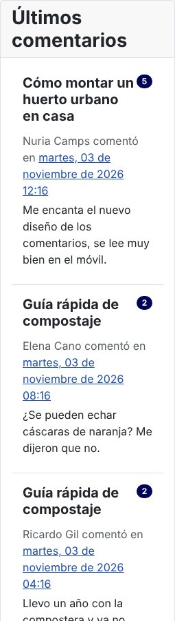

</details>

### Plugins

El paquete instala diez plugins. Se gestionan en Sistema › Gestionar › Plugins (busque «Engage»).

#### Contenido – Akeeba Engage (`content/engage`)

<!-- claves: ninguna -->
Muestra los comentarios y el formulario en los artículos. Es el plugin que hace que todo funcione: no lo desactive.

#### Sistema – Akeeba Engage soporte de caché (`system/engagecache`)

<!-- claves: ninguna -->
Hace que los comentarios se vean bien con la caché de página de Joomla activada. Actívelo si usa esa caché.

#### Akeeba Engage – Envío de emails (`engage/email`)

<!-- claves: email -->
Envía los avisos a moderadores y suscriptores.

| Opción | Qué hace | Valores |
|---|---|---|
| **Notificar a los administradores de comentarios todos los comentarios** (`managers_notify`) | ¿Notificar a los administradores de comentarios también los comentarios publicados automáticamente, que no necesitan moderar y que no son respuesta a un comentario suyo? | No / Sí. Por defecto: No |
| **Notificar a los administradores de comentarios los comentarios SPAM** (`managers_notify_spam`) | ¿Notificar a los administradores de comentarios cuando el mensaje recibido ya está marcado como SPAM (por ejemplo, por el plugin de integración con Akismet)? | No / Sí. Por defecto: No |

<details><summary>Ver la pantalla: Akeeba Engage – Envío de emails</summary>

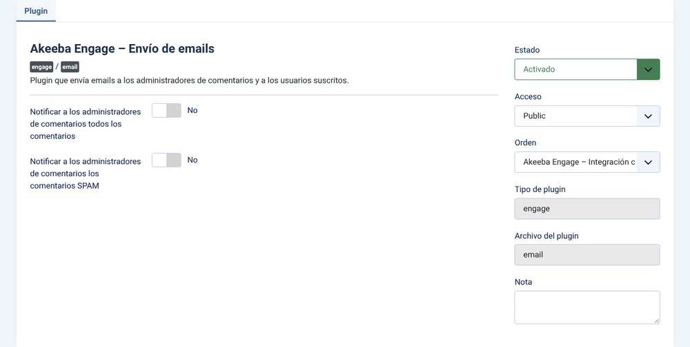

</details>

#### Akeeba Engage – Protección antispam de Akismet (`engage/akismet`)

<!-- claves: akismet -->
Consulta el servicio de pago Akismet para detectar spam. Solo funciona si pone su clave. Al usarlo, los datos del comentario se envían a Akismet.

| Opción | Qué hace | Valores |
|---|---|---|
| **Clave de Akismet** (`key`) | Su clave de API de Akismet (se obtiene en la cuenta de Akismet). | texto |
| **Comentarios que se comprueban en busca de SPAM** (`check`) | ¿Qué comentarios se deben comprobar en busca de SPAM? | Todos / Quien no sea administrador / Invitados. Por defecto: Quien no sea administrador |
| **Descartar el SPAM evidente** (`discard_blatant`) | Si se activa, los comentarios identificados como SPAM evidente se eliminarán de inmediato en lugar de guardarse y marcarse como SPAM. | No / Sí. Por defecto: Sí |

<details><summary>Ver la pantalla: Akeeba Engage – Protección antispam de Akismet</summary>

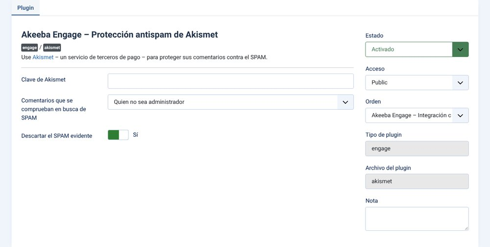

</details>

#### Akeeba Engage – Integración con Gravatar (`engage/gravatar`)

<!-- claves: gravatar -->
Muestra el avatar de Gravatar. Por defecto pide permiso al visitante antes de contactar con Gravatar.

| Opción | Qué hace | Valores |
|---|---|---|
| **Modo de Gravatar** (`mode`) | Este ajuste controla cuándo el navegador del visitante puede contactar con gravatar.com (esto envía la IP del visitante a un tercero). | Preguntar antes al visitante (recomendado) / Desactivado (nunca contactar con Gravatar) / Siempre (sin pedir consentimiento). Por defecto: Preguntar antes al visitante (recomendado) |
| **Mostrar el aviso de consentimiento** (`show_notice`) | Se muestra encima de los comentarios el aviso propio del plugin con el botón de aceptar. | No / Sí. Por defecto: Sí |
| **Quién decide (origen del consentimiento)** (`consent_source`) | Solo se aplica en el modo Preguntar. Aviso propio de Engage: el plugin muestra su propio botón encima de los comentarios (por defecto, sin cambios). | Aviso propio de Engage (por defecto) / Módulo JBCookies (gestor de cookies). Por defecto: Aviso propio de Engage (por defecto) |
| **Grupo de JBCookies (opcional)** (`jbcookies_group`) | Déjelo VACÍO (recomendado para empezar): las fotos solo se cargan cuando el visitante hace clic en Aceptar todas en JBCookies. | texto |
| **Mostrar enlace al perfil** (`profile_link`) | ¿Debe enlazarse el avatar con la página pública del perfil de Gravatar? | No / Sí. Por defecto: Sí |
| **Clasificación** (`rating`) | Clasificación de contenido que se permite a los avatares de Gravatar: G apta para todos; X no apta para el trabajo. | G (Apta para todos los públicos) / PG (Gestos groseros, desnudez parcial, palabrotas, violencia leve) / R (Lenguaje muy soez, violencia intensa, desnudez, consumo de drogas duras) / X (Imágenes sexuales explícitas, violencia extremadamente perturbadora). Por defecto: G (Apta para todos los públicos) |
| **Imagen por defecto** (`default_image`) | El avatar que se muestra si el usuario no tiene uno creado en Gravatar. Si se elige personalizada, seleccione una imagen en el campo de abajo. | Persona misteriosa / Identicon / MonsterID / Wavatar / Retro / RoboHash / Imagen en blanco / Imagen personalizada. Por defecto: Persona misteriosa |
| **Imagen personalizada por defecto** (`custom_default`) | Elija la imagen que se usará como avatar por defecto si la opción anterior es Imagen personalizada. | imagen de la biblioteca de medios |
| **Forzar imagen por defecto** (`force_default`) | ¿Mostrar siempre la imagen por defecto aunque el usuario tenga un Gravatar? | No / Sí. Por defecto: No |

<details><summary>Ver la pantalla: Akeeba Engage – Integración con Gravatar</summary>

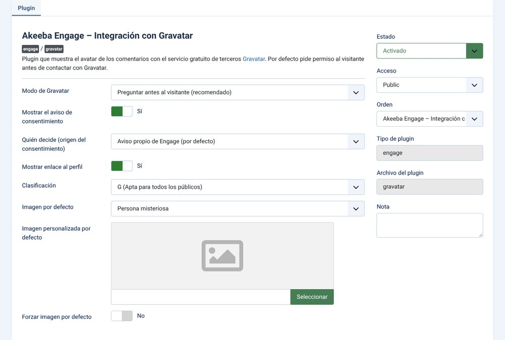

</details>

#### Usuario – Akeeba Engage (`user/engage`)

<!-- claves: user -->
Cuando se borra una cuenta, borra sus reacciones y denuncias y deja sus comentarios sin datos personales. Al iniciar sesión, asocia a la cuenta los comentarios de invitado cuyo correo ella tiene verificado.

| Opción | Qué hace | Valores |
|---|---|---|
| **Comentarios propios de invitado al iniciar sesión** (`own_comments`) | Cada vez que un usuario inicia sesión, Akeeba Engage buscará comentarios publicados como invitado con el mismo email que el usuario que ha iniciado sesión. | No / Sí. Por defecto: Sí |

<details><summary>Ver la pantalla: Usuario – Akeeba Engage</summary>

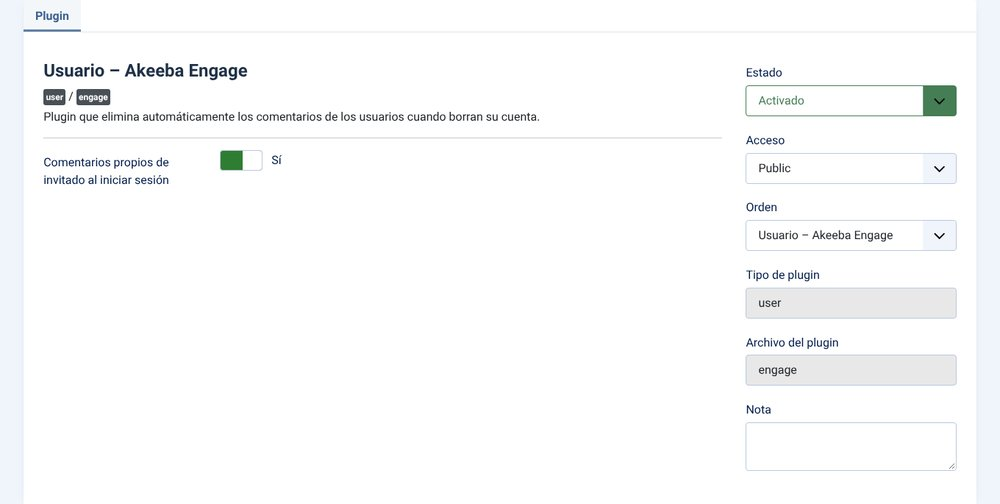

</details>

#### Registro de acciones – Akeeba Engage (`actionlog/engage`)

<!-- claves: actionlog -->
Anota en el registro de acciones de Joomla las acciones administrativas sobre los comentarios y los cambios hechos en la matriz de permisos.

| Opción | Qué hace | Valores |
|---|---|---|
| **Registrar comentarios** (`log_comments`) | ¿Registrar la creación de comentarios? Desactivado por defecto. Advertencia: ¡esto puede inflar su base de datos! | No / Sí. Por defecto: No |

<details><summary>Ver la pantalla: Registro de acciones – Akeeba Engage</summary>

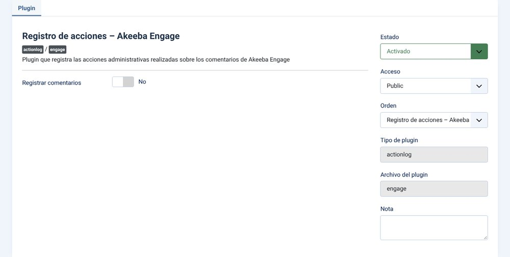

</details>

#### Privacidad – Akeeba Engage (`privacy/engage`)

<!-- claves: ninguna -->
Exporta y suprime los comentarios de una persona cuando usted atiende una solicitud en Usuarios › Privacidad.

#### Cumplimiento de datos – Akeeba Engage (`datacompliance/engage`)

<!-- claves: ninguna -->
Hace lo mismo para el componente de cumplimiento de datos de Akeeba (solo si lo tiene instalado).

#### Consola – Akeeba Engage (`console/engage`)

<!-- claves: ninguna -->
Añade comandos a la consola de Joomla, como `engage:cleanspam` para borrar el spam antiguo.

## Instalar

1. **Haga una copia de seguridad** de su sitio y de su base de datos.
2. Descargue el ZIP de la [última versión](../../releases/latest) (`pkg_engage-….zip`).
3. En Joomla: **Sistema › Instalar › Extensiones** (en versiones anteriores, Extensiones › Gestionar › Instalar), pestaña «Subir archivo», y suba el ZIP. Se instala encima de una versión anterior sin desinstalar nada.
4. Abra **Akeeba Engage** en el menú de administración: el semáforo del panel le dirá qué falta.

**Qué activar o revisar después:**

- **Plugins** (Sistema › Gestionar › Plugins): tras instalar quedan activos *Contenido*, *Envío de emails*, *Gravatar*, *Usuario* y *Consola*. Active además *Sistema – soporte de caché* si usa la caché de página, *Registro de acciones* si quiere ese registro, y *Privacidad* y *Cumplimiento de datos* si atiende solicitudes de datos. *Akismet* solo hace falta si va a usarlo, con su clave.
- **Menús:** no hacen falta. Los comentarios salen solos debajo de los artículos. Si quiere el módulo de últimos comentarios, créelo como se explica [arriba](#módulo-últimos-comentarios).
- **Permisos:** abra [Permisos](#matriz-de-permisos) y decida quién puede comentar, editar, moderar o borrar. Cuando acaba de instalar, los invitados no pueden comentar si usted no se lo permite.
- **Privacidad:** en [Opciones: Privacidad y Gravatar](#opciones-privacy) ponga el enlace a su política de privacidad y compruebe el plazo de conservación de la IP (12 meses por defecto, que es también el máximo).
- **Moderación:** en [Opciones: Moderación](#opciones-moderation) elija si los comentarios nuevos esperan aprobación.

<details>
<summary>Actualizar</summary>

Suba el ZIP de la versión nueva igual que al instalar: se instala encima, conserva los comentarios, las opciones y los permisos, y crea por sí sola las tablas nuevas que haga falta. Si tiene instalada la versión original de Akeeba Engage 3.4.2, Joomla le ofrece la actualización en Sistema › Actualizar › Extensiones (servidor de actualizaciones de este proyecto) o puede subir el ZIP a mano. Haga copia de seguridad antes. Cambios de cada versión en [`CHANGELOG.md`](CHANGELOG.md).

</details>

<details>
<summary>Desinstalar</summary>

En Sistema › Gestionar › Extensiones, busque «Engage» y desinstale el **paquete** (`pkg_engage`): quita todas sus extensiones. **Atención: al desinstalar se borran las tablas de Engage** (comentarios, reacciones, denuncias, bajas de avisos) y sus plantillas de correo. Haga antes una copia de seguridad si quiere conservar los comentarios.

</details>

<details>
<summary>Instalación avanzada, compilar y probar</summary>

Para generar el ZIP usted mismo hace falta PHP 8 en línea de comandos con `zip` y `simplexml`:

```
php build/build.php       # genera dist/pkg_engage-<versión>.zip
php build/verificar.php   # comprueba el resultado y ejecuta las pruebas
composer install --working-dir=tests   # una vez: librerías de Joomla usadas por las pruebas
php tests/run.php                      # pruebas ejecutables
```

El ZIP es reproducible (mismo contenido, mismo sha256). Las pruebas contra un Joomla real están explicadas en [`tests/joomla-live/LEEME.md`](tests/joomla-live/LEEME.md). Cómo se publica una versión: [`docs/PUBLICAR-RELEASE.md`](docs/PUBLICAR-RELEASE.md).

</details>

## Seguridad

<details>
<summary>Qué hace el código para proteger su sitio y a sus visitantes</summary>

No prometemos que un programa sea «seguro»: decimos lo que hace y lo que se ha revisado.

- **Contra acciones falsas (CSRF):** toda acción que cambia datos exige el token de formulario de Joomla. Los enlaces de moderación y de baja de los correos van **firmados** y caducan a las 24 horas; un enlace firmado no sirve para otra tarea.
- **Permisos en el servidor:** cada acción comprueba los permisos de Joomla (ACL) en el servidor, no solo oculta botones. Las opciones sensibles las cambia únicamente quien tiene el permiso «Administrador».
- **Tareas en lista cerrada:** los controladores de la administración y los de los comentarios de la web solo aceptan las tareas de una lista fija; cualquier otra recibe un 403.
- **Base de datos:** las consultas usan parámetros enlazados de Joomla, y los órdenes y filtros salen de listas fijas.
- **Lo que se muestra:** todo se escapa al imprimirlo. El HTML de los comentarios se limpia siempre con HTML Purifier 4.19.1 (salvo que usted elija el modo «Filtros de texto de Joomla»), y hay un tope duro de 20 000 bytes por comentario.
- **Sin recursos externos:** el panel, los correos y los scripts propios no cargan nada de terceros. El empaquetador rechaza cualquier dirección externa, imagen, correo real o código peligroso en el ZIP. Los únicos servicios externos son opcionales: Gravatar, Akismet y, si usted pone una dirección, el enlace de consulta de IP de los moderadores.
- **Privacidad (RGPD):** la IP y el navegador de cada comentario se borran a los 12 meses como máximo (el comentario se conserva); el formulario informa de lo que se guarda; Gravatar solo se carga si el visitante lo acepta, y esa decisión se toma en el servidor; los comentarios se exportan y se suprimen con las herramientas de privacidad de Joomla.
- **Denuncias con límites:** solo usuarios registrados, una por persona y comentario, con tope por hora y por día, antigüedad mínima de la cuenta y tope de denuncias abiertas.
- **Revisiones:** el código pasó por cinco auditorías independientes; los hallazgos confirmados (el más grave, de gravedad alta: un abuso de CPU con códigos BBCode) están corregidos y cada corrección tiene su prueba. Hay pruebas automáticas y pruebas contra un Joomla real.

Más detalle: [`docs/INFORME-FASE2-JOOMLA6.md`](docs/INFORME-FASE2-JOOMLA6.md), [`docs/PRUEBAS-SEGURIDAD-JOOMLA6.md`](docs/PRUEBAS-SEGURIDAD-JOOMLA6.md), [`docs/RESULTADOS-PRUEBAS-JOOMLA-REAL.md`](docs/RESULTADOS-PRUEBAS-JOOMLA-REAL.md), [`docs/PRIVACIDAD.md`](docs/PRIVACIDAD.md), [`docs/GRAVATAR-CONSENTIMIENTO.md`](docs/GRAVATAR-CONSENTIMIENTO.md), [`docs/DENUNCIAS.md`](docs/DENUNCIAS.md) y [`CHANGELOG.md`](CHANGELOG.md). Si encuentra un fallo de seguridad, avise en privado al autor antes de publicarlo.

</details>

## Más documentación

Estado del proyecto, novedades respecto a Akeeba Engage 3.4.2 y estructura del repositorio: [`docs/PROYECTO.md`](docs/PROYECTO.md). Guías: [`docs/PANEL.md`](docs/PANEL.md), [`docs/TEMAS.md`](docs/TEMAS.md), [`docs/RESPUESTAS-DISENO.md`](docs/RESPUESTAS-DISENO.md), [`docs/REACCIONES.md`](docs/REACCIONES.md), [`docs/ORDEN-Y-FAVORITOS.md`](docs/ORDEN-Y-FAVORITOS.md), [`docs/CORREOS.md`](docs/CORREOS.md), [`docs/AVATARES.md`](docs/AVATARES.md), [`docs/ROBOTS-Y-TRAFICO.md`](docs/ROBOTS-Y-TRAFICO.md), [`docs/DATOS-ESTRUCTURADOS.md`](docs/DATOS-ESTRUCTURADOS.md) y [`docs/COMENTARIOS-EN-OTROS-COMPONENTES.md`](docs/COMENTARIOS-EN-OTROS-COMPONENTES.md) (para desarrolladores).

## Autor y licencia

**Desarrollado por ChasKa.** Es una bifurcación (*fork*) comunitaria de **Akeeba Engage 3.4.2**, de Nicholas K. Dionysopoulos / Akeeba Ltd, cuyo desarrollo se detuvo en 2025. No es un producto de Akeeba Ltd ni está respaldado por ella. Se conservan los avisos de copyright del original ([`NOTICE.md`](NOTICE.md)).

**Licencia:** GNU General Public License versión 3 o posterior. Texto completo en [`LICENSE`](LICENSE).

### Colaborar: traducciones

Engage viene en español e inglés y puede traducirse a más idiomas. No hace falta saber programar. Guía paso a paso: [`docs/TRADUCIR.md`](docs/TRADUCIR.md). Cómo colaborar (traducciones, errores y cómo avisar de un fallo de seguridad sin publicarlo): [`CONTRIBUTING.md`](CONTRIBUTING.md). La herramienta `php build/idiomas.php comprobar xx-XX` comprueba una traducción antes de enviarla.

*English:* Unofficial community fork of Akeeba Engage, comments for Joomla articles (Joomla 5 and 6). GPL-3.0-or-later. Developed by ChasKa. Not affiliated with Akeeba Ltd.

<details>
<summary>Componentes de terceros que lleva el paquete</summary>

| Componente | Para qué | Licencia |
|---|---|---|
| [HTML Purifier](https://github.com/ezyang/htmlpurifier) 4.19.1, de Edward Z. Yang | Limpia el HTML de los comentarios | LGPL 2.1 o posterior |
| [Composer](https://getcomposer.org) (solo el cargador automático de clases), de Nils Adermann y Jordi Boggiano | Carga HTML Purifier | MIT |
| Fuente `Akeeba-Products.woff`, de Akeeba Ltd | Iconos del panel, incluida en la obra original | La licencia concreta no consta en los archivos y está pendiente de revisar |

Engage usa además las bibliotecas de Joomla que ya están en su sitio; no se incluyen en el paquete. Servicios opcionales de terceros que usted puede activar: [Gravatar](https://gravatar.com) y [Akismet](https://akismet.com). La integración opcional con JBCookies no se distribuye con el paquete.

</details>

**Marcas:** Joomla! es una marca de Open Source Matters, Inc.; este proyecto no está afiliado a ella. Akeeba es marca de sus titulares.

